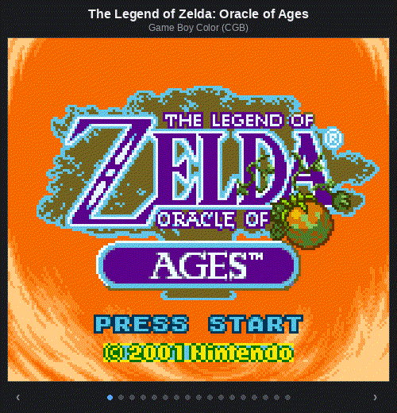

# gbc-emu

A Game Boy (GB) and Game Boy Color (GBC) emulator written in C++17 using SDL2.

By [Brandon Gartner](https://github.com/brandon-gartner)

---

## Screenshots

<div align="center">
  
</div>

<br>

<details>
<summary><b>📷 Click here to view individual static screenshots</b></summary>
<br>

| *The Legend of Zelda: Link's Awakening DX* (GBC) | *Pokémon Gold* (GBC) |
| :---: | :---: |
|  |  |

| *The Legend of Zelda: Link's Awakening* (GB) | *Tetris* (GB) |
| :---: | :---: |
|  |  |

| *Dr. Mario* (GB) | *DMG-Acid2* (PPU Test) |
| :---: | :---: |
|  |  |

</details>

---

## Building & Running

### Prerequisites
- **C++17** compatible compiler (GCC `g++` or Clang)
- **Make**
- **SDL2** development libraries

#### Installing Dependencies

On **Ubuntu / Debian**:
```bash
sudo apt update
sudo apt install build-essential libsdl2-dev
```

On **macOS** (Homebrew):
```bash
brew install sdl2
```

### Compiling

Build the emulator binary:
```bash
make all
```

Clean artifacts:
```bash
make clean
```

### Usage

```bash
./emu <path-to-rom>
```

**Examples:**
```bash
./emu roms/tetris.gb
./emu roms/pokemon_gold.gbc
```

---

## Controls

| Game Boy Button | Primary Key | Alternate Key |
| :--- | :--- | :--- |
| **D-Pad Up** | `Up Arrow` | |
| **D-Pad Down** | `Down Arrow` | |
| **D-Pad Left** | `Left Arrow` | |
| **D-Pad Right** | `Right Arrow` | |
| **A** | `Z` | `J` |
| **B** | `X` | `K` |
| **Start** | `Return` (Enter) | |
| **Select** | `Backspace` | `Space` / `Right Shift` |

### Emulator Hotkeys

| Function | Key | Notes |
| :--- | :--- | :--- |
| **Turbo Mode** | `Tab` | Hold to uncap framerate |
| **Quit / Exit** | `Escape` | Exits and closes the window |

---
## Features

### Full DMG (GameBoy) & CGB (GameBoy Color) Support
Automatic hardware mode detection from the cartridge header, with full DMG backwards-compatibility (authentic boot register values, DMG palette mapping, and correct sprite priority rules).

CGB Double-Speed Mode, including the `KEY1` speed-switch register and `STOP`-based transition mechanism, with cycle scaling applied consistently across CPU, timers, and PPU.

### PPU Accuracy
Passes DMG-Acid2 with a 100% pixel-perfect reference image, a widely used correctness benchmark specifically designed to catch subtle PPU bugs (window/background layering, sprite priority edge cases) that many scanline renderers get wrong.

Implements a window internal line counter, which prevents visual tearing when the window layer is toggled or repositioned mid-frame. This is a known edge case that trips up most first-pass PPU implementations.

Full CGB color pipeline: 64-entry background/object palettes with auto-increment indexing, correct BG-to-OAM priority resolution, and accurate 15-bit-to-32-bit color conversion.

### DMA Handling
Implements CGB HDMA with block-by-block transfer during Mode 0, including transfer cancellation and LCD-off fallback handling for cases where the LCD is disabled mid-transfer.

### Cartridge & Memory
MBC1, MBC3 (with RTC latching), and MBC5 support, plus full VRAM/WRAM banking, covering all standard mapper types.

---

## Project Structure

```
.
├── src/
│   ├── main.cpp              # Entry point and argument parsing
│   ├── emulator.cpp/.h       # Top-level orchestrator and hardware mode manager
│   ├── processor.cpp/.h      # Sharp SM83 CPU execution and instruction decoding
│   ├── instruction.cpp/.h    # Opcode execution logic and CB prefix handlers
│   ├── ppu.cpp/.h            # Picture Processing Unit, palettes, scanlines, sprites
│   ├── databus.cpp/.h        # 16-bit memory bus routing
│   ├── cartridge.cpp/.h      # ROM/RAM header parsing and MBC mappers (MBC1, MBC3, MBC5)
│   ├── RAM.cpp/.h            # Internal RAM (WRAM, HRAM, VRAM)
│   ├── display.cpp/.h        # SDL2 rendering, frame synchronization, and event polling
│   ├── joypad.cpp/.h         # Joypad input register handling
│   ├── timer.cpp/.h          # DIV and TIMA timer emulation
│   ├── interrupt.cpp/.h      # Interrupt controller (VBlank, LCD, Timer, Serial, Joypad)
│   ├── stack_c.cpp/.h        # Hardware stack helper
│   └── shared.h              # Bitwise utilities and shared definitions
├── tests/                    # 11 unit & integration test suites
├── resources/                # Screenshots, memory maps, and documentation
└── roms/                     # Test ROMs and demo titles
```

---

## Planned Improvements

- [ ] **APU (Audio Processing Unit)**: Emulate Sound Channels 1–4 (Square waves with sweep/envelope, programmable Wave, Noise).
- [ ] **SRAM Persistence**: Automatically save and load battery-backed cartridge RAM (`.sav` files) on disk.
- [ ] **Save States**: Snapshot and restore full emulator state to disk.
- [ ] **RTC File Saving**: Save and restore MBC3 Real-Time Clock timestamp to disk.
- [ ] **Configurable Keybindings**: Load custom input mappings from a configuration file.

---

## References

- **[Pan Docs](https://gbdev.io/pandocs/)**
- **[RGBDS Documentation (v1.0.3)](https://rgbds.gbdev.io/docs/v1.0.3/)**
- **[The Cycle-Accurate Game Boy Docs](https://github.com/geaz/emu-gameboy/blob/master/docs/The%20Cycle-Accurate%20Game%20Boy%20Docs.pdf)** 
- **[Game Boy: Complete Technical Reference](https://gekkio.fi/files/gb-docs/gbctr.pdf)** 
- **[Gekkio's Game Boy Hardware Database](https://gbhwdb.gekkio.fi/)** 
- **[Pastraiser's Game Boy CPU Opcode Table](http://www.pastraiser.com/cpu/gameboy/gameboy_opcodes.html)**
- **[gbdev Interactive Opcode Table](https://gbdev.io/gb-opcodes/optables/)**
- **[The Ultimate Game Boy Talk (33c3)](https://www.youtube.com/watch?v=HyzD8pNlpwI)**
- **[GameBoy Emulation in JavaScript](http://imrannazar.com/GameBoy-Emulation-in-JavaScript)**
- **[Gameboy-logs](https://github.com/wheremyfoodat/Gameboy-logs)**
- **[Blargg's Test ROMs](https://github.com/retrio/gb-test-roms)**
- **[Mooneye GB Test Suite](https://github.com/Gekkio/mooneye-test-suite)**
- **[dmg-acid2](https://github.com/mattcurrie/dmg-acid2)**
- **[cgb-acid2](https://github.com/mattcurrie/cgb-acid2)**
